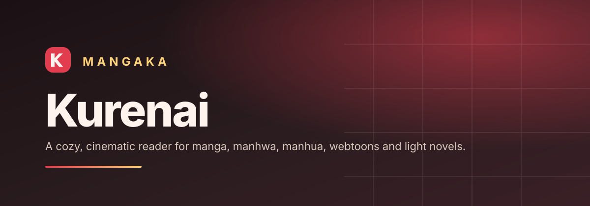

<div align="center">



**[Mangaka](https://github.com/fleurdeur/Mangaka) is a free and open-source native Android reader for manga, manhwa, manhua, webtoons, comics and light novels. It is the spiritual successor to Kotatsu Redo: cozy to use, cinematic to look at, and built to stay fast on real devices.**


[](https://github.com/fleurdeur/Mangaka/actions/workflows/android.yml)
[](https://github.com/fleurdeur/Mangaka/releases)
[](https://github.com/fleurdeur/Mangaka/blob/main/LICENSE)

</div>

### Main Features

<div align="left">

-   Large online catalogue through the open-source Kotatsu parser ecosystem, with per-source languages, content ratings, health tracking, enable/disable and automatic disabling of repeatedly failing sources
-   Search one source or all enabled sources at once, by title, author, tag or kind, with native filter sheets and streamed multi-source results
-   Favourites in custom categories, reading history, bookmarks, incognito mode and a continue-reading widget
-   Four reading directions: paged left-to-right, paged right-to-left, vertical and continuous Webtoon; double-page spreads on wide screens
-   Tap zones, volume-key paging, keyboard, gamepad and D-pad navigation, stylus support, auto-scroll, reading light, sleep timer, e-ink and colour-filter modes
-   Per-series reader settings, adaptive prefetch, tiled decoding and a configurable disk cache
-   New chapter checks, an updates feed, smart download suggestions and offline chapter downloads through WorkManager
-   Local recommendations, cross-source title matching and "Alternatives" for moving progress between sources
-   Tracking with AniList, MyAnimeList, Kitsu and Shikimori; encrypted backup and restore
-   Network tools: encrypted cookie jar, DNS over HTTPS, HTTP/SOCKS proxy, polite rate limiting, circuit breakers and Cloudflare/WebView challenge handling with a human fallback
-   On-device OCR and ML Kit translation, plus an optional OpenAI-compatible cloud/local LLM adapter
-   **Animated chapters (experimental):** panel detection, lightweight character rigs, a director camera plan, real-time OpenGL ES rendering, voice casting, system/offline/neural TTS, karaoke subtitles and a manual editor
-   Material 3 Expressive design with Inter typography, a coffee/crimson palette, Monet dynamic colour, AMOLED black and cover-adaptive themes
-   Password or biometric app lock, adult-content gating, no ads, no analytics and no account required
-   Phones, tablets, foldables, Android TV/Leanback and Wear OS remote hooks
-   Supports Android 8.0 and newer

</div>

### Design

<div align="center">

**Coffee, cream and crimson.** Kurenai uses a warm espresso surface, a crimson accent and a soft gold highlight, with expressive shapes, generous spacing and cinematic gradients. The reader stays out of the way; the library feels like a favourite shelf.

</div>

<div align="left">

-   System, light, dark and pure-black AMOLED themes
-   Material You dynamic colour when the device supports it
-   Cover-adaptive palette for the details screen
-   Reduced-motion and photosensitivity-safe options for animated chapters
-   Large touch targets, visible focus states, TV-safe layouts and gamepad navigation

</div>

### Animated Chapters

<div align="left">

Kurenai can turn a chapter page into a short cinematic sequence: panels are detected, light rigs are generated, a director adds push-ins, pans and parallax, and a real-time OpenGL ES renderer brings the page to life with narration and karaoke subtitles. It runs on-device, can be disabled in settings and respects reduced-motion settings.

The pipeline and its current limitations are documented in [docs/ANIMATED_CHAPTERS.md](docs/ANIMATED_CHAPTERS.md).

</div>

### Contributing

**📌 Pull requests are welcome.** Read [CONTRIBUTING.md](CONTRIBUTING.md) for build steps, code style, source rules and the review checklist. By contributing you agree your work is licensed under GPL-3.0.

-   [Report a bug](https://github.com/fleurdeur/Mangaka/issues/new?template=bug_report.yml)
-   [Report a source issue](https://github.com/fleurdeur/Mangaka/issues/new?template=source_issue.yml)
-   [Request a feature](https://github.com/fleurdeur/Mangaka/issues/new?template=feature_request.yml)
-   Security reports: [SECURITY.md](SECURITY.md) — please do not open a public issue

### Building

```bash
# JDK 17+ and Android SDK platform 37
./gradlew :app:assembleDebug
```

The debug universal APK is written to `app/build/outputs/apk/debug/app-universal-debug.apk`. ABI-specific debug APKs are written beside it.

For a signed release build, create a local `signing.properties` (never commit it):

```properties
storeFile=/absolute/path/to/release.jks
storePassword=...
keyAlias=...
keyPassword=...
```

```bash
./gradlew :app:assembleRelease
```

Release builds produce:

- `app-arm64-v8a-release.apk` — 64-bit ARM phones and tablets
- `app-armeabi-v7a-release.apk` — 32-bit ARM devices
- `app-universal-release.apk` — every bundled ABI
- optional `x86` / `x86_64` APKs for emulators

All are signed with the main release keystore configured in `signing.properties`.

### Certificate fingerprints

```plaintext
SHA-256: 20:A6:B9:D6:AD:A0:57:78:7D:E3:20:C5:48:21:E9:CA:D6:CB:81:CE:37:8F:9D:E9:EE:F3:EA:C5:09:E9:E3:4B
```

```plaintext
SHA-1: 3A:86:68:4E:43:AD:5C:F6:19:B1:3B:A4:DD:00:9B:7F:BE:8E:DC:E5
```

### License

[](http://www.gnu.org/licenses/gpl-3.0.en.html)

<div align="left">

You may copy, distribute and modify the software as long as you track changes/dates in source files. Any modifications to or software including (via compiler) GPL-licensed code must also be made available under the GPL along with build and install instructions.

Kurenai includes the Kotatsu parser library, which is also GPL-3.0. See [docs/SOURCES.md](docs/SOURCES.md) for attribution and source rules.

</div>

### DMCA disclaimer

<div align="left">

The developers of this application do not have any affiliation with the content available in the app and do not store or distribute any content. This application should be considered a web browser; all content that can be found using this application is freely available on the Internet. All DMCA takedown requests should be sent to the owners of the website where the content is hosted. See [docs/DMCA.md](docs/DMCA.md) for the project's takedown process.

</div>
